# TCMS UI

React frontend for the Test Case Management System: projects, test cases, test suites, test execution,
defects, attachments and an analytics dashboard, with role-based access for admins, test leads, testers and
read-only users.

- Requirements: the Full Stack Test Case Management System assignment. [PRD coverage](#prd-coverage) maps
  its frontend requirements to the code.
- Backend: the separate tcms-api repository (Node.js, Express, PostgreSQL). Its `document/user-guide.md`
  describes the server-side rules behind the screens below.

## Contents

- [Tech stack](#tech-stack)
- [Local development](#local-development)
- [Demo credentials](#demo-credentials)
- [User guide](#user-guide)
- [PRD coverage](#prd-coverage)
- [Environment](#environment)
- [Scripts](#scripts)
- [Project structure](#project-structure)

## Tech stack

React 19 (React Compiler) · TypeScript · Vite · Ant Design · React Router · TanStack Query · axios ·
react-hook-form + zod · i18next · Recharts · MSW (mock API in development) · Vitest

## Local development

Requires Node 24 (see `.nvmrc`).

```bash
nvm use
npm install
npm run dev
```

With mocking on (`VITE_TCMS_API_MOCKING=true`, the default), the app runs against the MSW mock API, so no
backend is required. To use the real backend instead, see [Environment](#environment).

## Demo credentials

### Mock API (default)

Every account below signs in with the password **`Tcms-Mock-1`** (`MOCK_USER_PASSWORD` in
`src/features/user/mock/user.mock.data.ts`). These accounts exist only in the mock API.

| Role | Name | Email |
| --- | --- | --- |
| Admin | Asha Admin | `admin@tcms.test` |
| Test lead | Leena Lead | `lead@tcms.test` |
| Tester | Tarun Tester | `tester@tcms.test` |
| Read-only | Rohan Reader | `readonly@tcms.test` |
| Tester, deactivated | Ivan Inactive | `inactive@tcms.test` (shows the "account deactivated" error) |

Good to know:

- **Sample data:** "Customer Portal" has about 1,000 test cases, suites, and executions spread over the last
  90 days, and all four accounts are on its team. Other projects are smaller, and not every account is on
  every team.
- **Changes last until a full page reload**, which resets the mock data. Your sign-in survives the reload.
- **Invitations:** an invited user gets no email in mock mode. The browser console prints the set-password
  link instead.

### Real backend

Load the demo data in tcms-api with `npm run seed:demo` (see its README). It creates three projects (ShopFront
Web, PayWallet Mobile, Partner API) with 400 test cases and 60 days of history, and one login per role. Every
login's password is the `DEMO_USER_PASSWORD` set in the backend's `.env`; it is never stored in either repository.

| Role | Name | Email |
| --- | --- | --- |
| Admin | Alex Morgan | `admin@tcms-demo.example` |
| Test lead | Priya Raman | `lead@tcms-demo.example` |
| Tester | Sam Carter | `tester@tcms-demo.example` |
| Tester | Mei Tanaka | `tester2@tcms-demo.example` |
| Read-only | Jordan Blake | `readonly@tcms-demo.example` |

The two testers are on different teams, so project scoping shows: each sees ShopFront Web and one other project.

Without the demo data, create the first admin with `npm run admin:create` (password from `INITIAL_ADMIN_PASSWORD`),
sign in, and invite one user per role from **Users**. Each invitee gets an email (Mailpit in development) with a
set-password link.

## User guide

### Getting around (every role)

- **Signing in:** there is no self-registration. An admin invites you; the email's link opens a page where you
  choose your password (at least 8 characters). The link works once and expires after 72 hours. On the real
  backend a session lasts 1 hour; after that, any action takes you back to sign-in, which returns you to the
  page you were on.
- **Sidebar:** **Dashboard** and **Projects** for everyone, **Users** and **Cache metrics** for admins. Inside a project, a section
  titled with the project's name holds its **Overview**, **Test cases**, **Test suites** and **Executions**.
- **Project switcher** (header, left): jump to another project. You stay in the same section, e.g. its test
  case list.
- **Theme** (header, moon/sun button): switch between light and dark. The app starts light; your choice is
  remembered in this browser.
- **Account menu** (header, your name): your email and role, and **Sign out**.
- **Lists** are paged (20, 50 or 100 per page) and sorted by name or title, A to Z, unless you click another
  column header. Search, filters, sorting and the page are part of the address, so a link or a refresh keeps
  them.
- **Leaving a form** with unsaved changes asks before discarding them.
- **Dates** are shown as `18 Nov 2026` and times as `18 Nov 2026, 02:30 PM`, in your own time zone.

### What each role can do

| | Admin | Test lead | Tester | Read-only |
| --- | :-: | :-: | :-: | :-: |
| Dashboard, test cases, suites, executions, suite reports, defects: view | ✓ | ✓ | ✓ | ✓ |
| Attachments: download | ✓ | ✓ | ✓ | ✓ |
| Projects: view | all | own | own | own |
| Projects: create, edit details and team | ✓ | own | | |
| Test cases and suites: create, edit, delete, bulk actions, reorder | ✓ | ✓ | | |
| Assign test cases to testers; run a suite for someone else | ✓ | ✓ | | |
| Run tests, record results, upload attachments, create defects | ✓ | ✓ | ✓ | |
| Users: invite, edit, change role, deactivate | ✓ | | | |
| Cache metrics | ✓ | | | |

"Own" means projects you are a member of. Everyone except admins sees only the projects they are on; any
other project's link shows "not found".

Buttons you can never use are hidden. The exception is running tests: for read-only users, **Execute**,
**Run suite**, **Record result**, **Choose files** and **Create defect** stay visible but disabled, with a
tooltip giving the reason.

### Dashboard (every role)

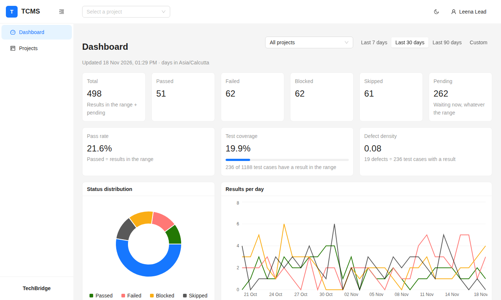

- **Filters** (top right): **All projects** or one project, and the last 7, 30 (default) or 90 days, or a custom
  range of up to 366 days.
- **Stat cards:** total, passed, failed, blocked, skipped and pending, plus pass rate, test coverage and defect
  density. "—" means there is nothing to divide by yet.
  - **Pending** is the work waiting now, whatever the range.
  - **Pass rate** = passed ÷ results recorded in the range.
  - **Coverage** = test cases with a result in the range ÷ all test cases.
- **Charts:**
  - status distribution;
  - results per day;
  - results and pending by priority or by type;
  - progress by tester.

  Hover for exact numbers. Click a legend item to hide or show a series; this also works with the keyboard.

### Admin

Admins can do everything below for every project, and are the only role that manages users.

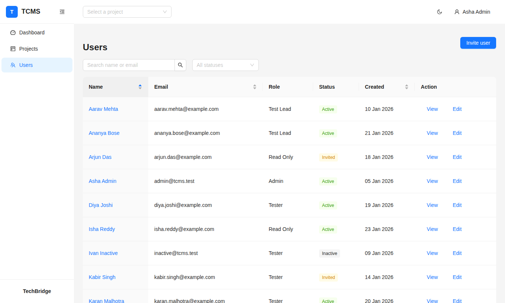

- **Invite a user** (**Users → Invite user**):
  - Enter a first name, email and role; the last name is optional.
  - The user shows as **Invited** until they set a password.
  - If the email couldn't be sent, the user is still saved: open them and click **Resend invitation**.
- **Edit a user:** change their name, email or role. Changing an invited user's email sends the invitation to
  the new address.
- **Deactivate / Activate** (a user's page): deactivating signs them out on their next action. Users are never
  deleted, so their name stays on the history they created.
- You can't change your own role or status.
- **Projects:** create projects and edit any project's details and team (**Projects → Add Project**, or **Edit**
  on a project).
- **Cache metrics** (sidebar): how well the API's cache works. For each cached read (dashboard analytics, test
  suite lists, project details): how often the answer came from the cache (hit rate), and the average time of a
  cached answer against one from the database. The counters start when the API starts; **Refresh** reloads them.

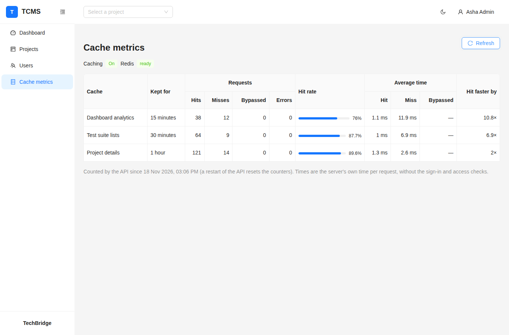

### Test lead

Test leads organize the testing for the projects they are on.

- **Projects:** create a project and pick its team (search by name or email). You always stay on the team of
  a project you edit.
- **Test cases** (**Test cases → Add test case**):
  - Each has a title, priority, type, description, pre- and post-conditions, tags, suites, and 1–100 steps
    (an action and its expected result).
  - Add, remove and reorder steps in the form. Tags are saved in lowercase.
- **Find test cases:** search titles and descriptions, and filter by priority, type, tags, suite and last result.

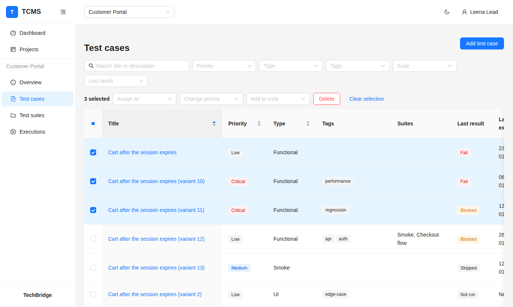

- **Bulk actions:** tick test cases on the current page, then **Assign to** a tester, **Change priority**,
  **Add to suite** or **Delete**. It's all or nothing: if a selected case was deleted meanwhile, nothing changes.
- **Suites** (**Test suites → Add test suite**):
  - **Add test cases** appends them at the end of the suite.
  - Change the order with the arrows on each row.
  - Removing a case from a suite, or deleting the suite, never deletes the test case.

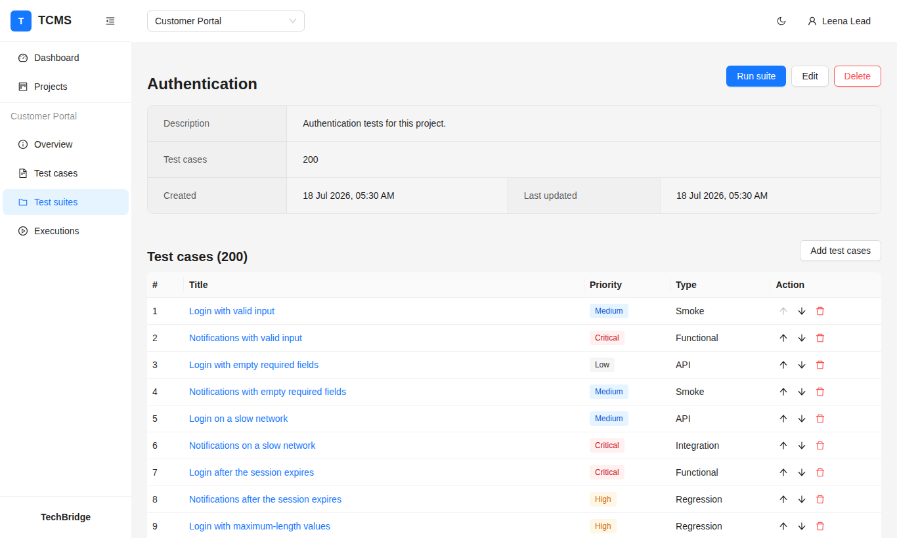

- **Run a suite** (**Run suite** on the suite's page):
  - Choose who it's for: you, unassigned (anyone can pick it up from **All pending**), or a team member.
  - This creates one pending run per test case, in suite order, and opens the run's report.

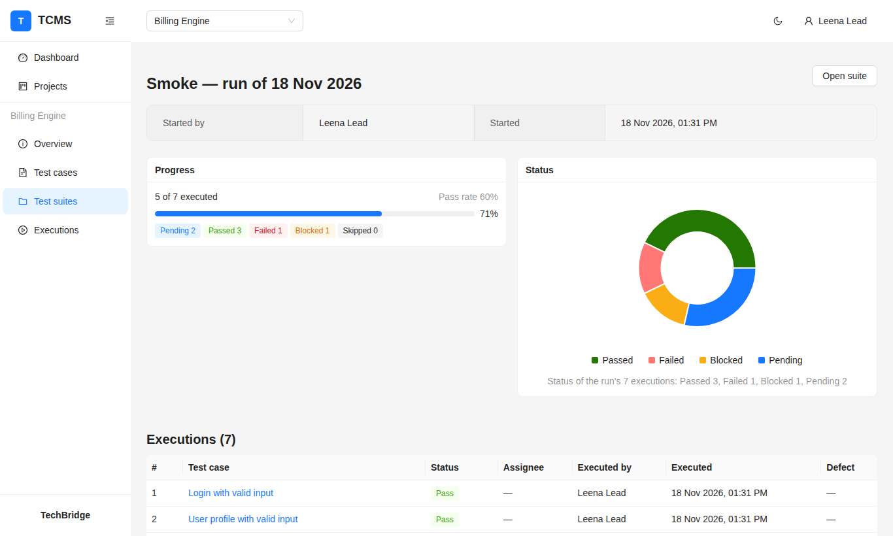

- **Running tests** works as for testers, below.

### Tester

Testers execute tests and report what they find.

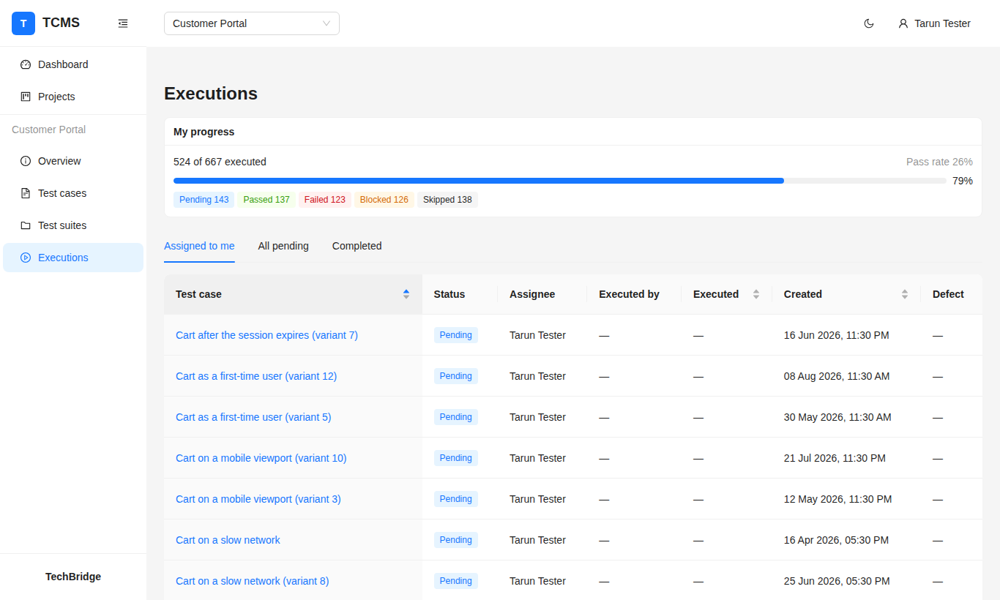

- **Executions:** **Assigned to me**, **All pending** and **Completed**, with your progress (or the project's)
  at the top. You may record any pending run of the project, not only your own.
- **Record a result:**
  1. Open a pending run.
  2. Optionally give each step a result and a comment.
  3. Pick **Pass**, **Fail**, **Blocked** or **Skipped**, add a comment, and click **Record result**.

  If a step failed, the run can't pass.

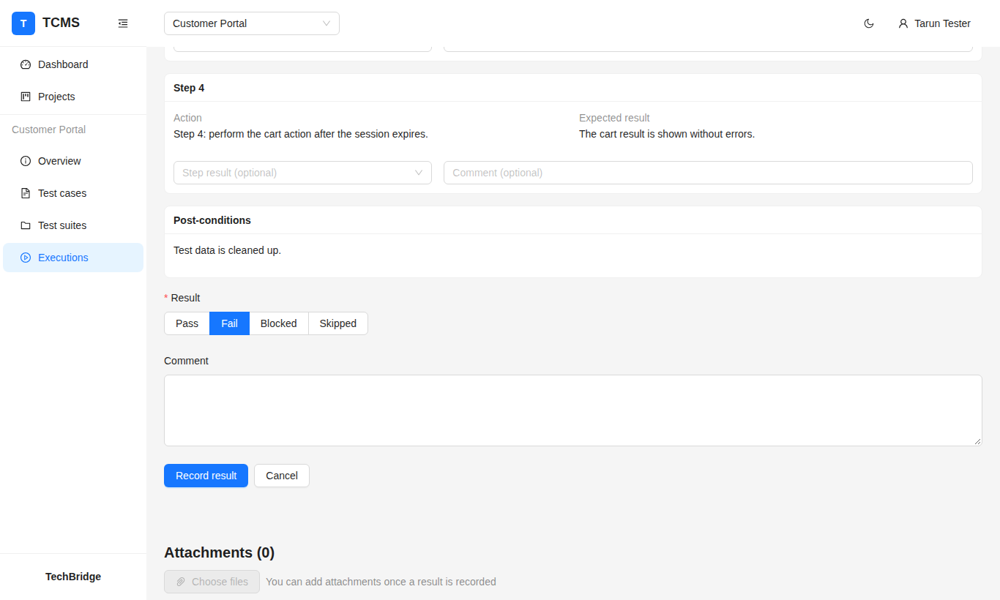

- **Results are final.** To correct one, click **Run again**, which starts a new run. If someone else recorded
  the same run first, the page shows their result.
- **Run without an assignment:** **Execute** on a test case's page records a result straight away.
- **After recording,** on the same page:
  - **Create defect** (failed runs only, one per run): the title and steps to reproduce are filled in for you;
    pick a severity.
  - **Attachments:** **Choose files**, then **Upload**. Up to 5 files at a time, 10 MB each; PNG, JPG, GIF,
    PDF, TXT, LOG or CSV. Attachments can be added only once a result is recorded.

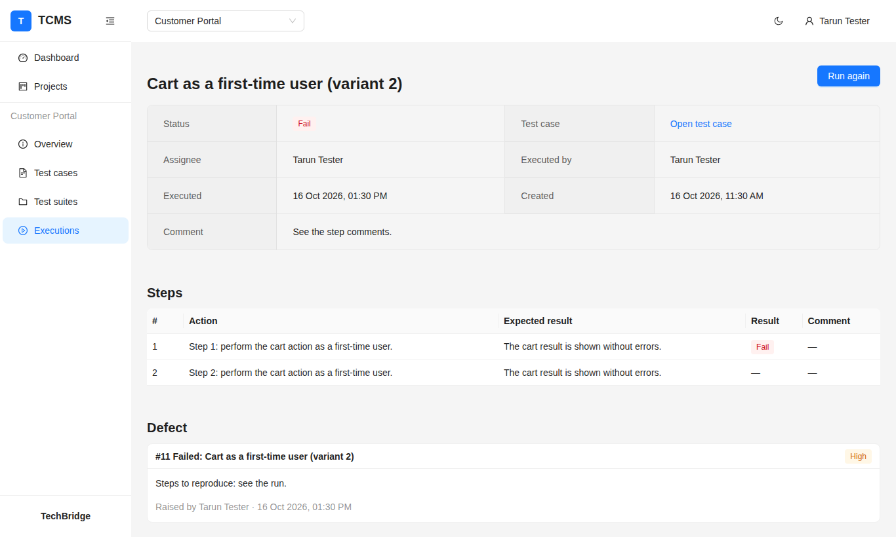

- **History:** a test case's page lists all its runs under **Execution history**. Each run's page shows its
  **Audit trail**: who created, assigned and recorded it, and who added files or a defect, with the time of
  each.

### Read-only

Read-only users follow the work without changing it. In their projects they can view:

- the dashboard;
- test cases, suites and suite reports;
- the execution queue, runs, history and audit trail;
- defects.

They can also download attachments.

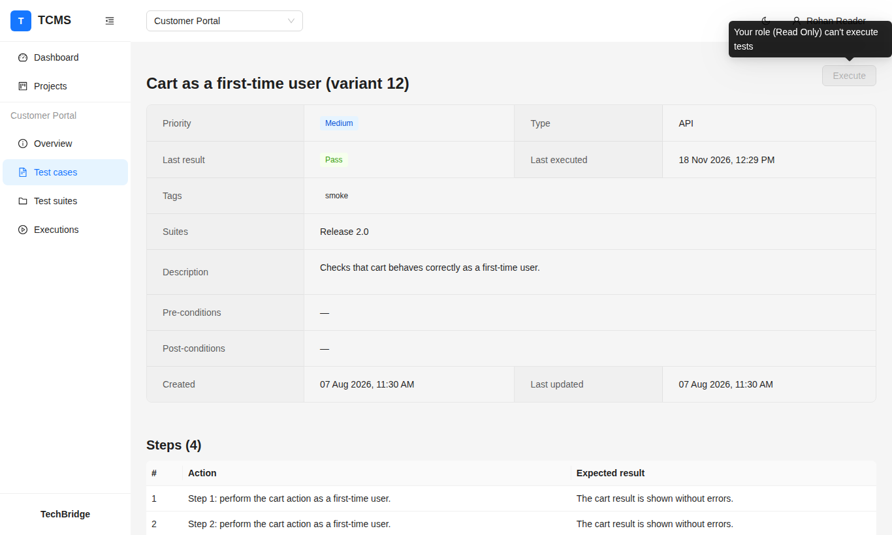

### Dark theme

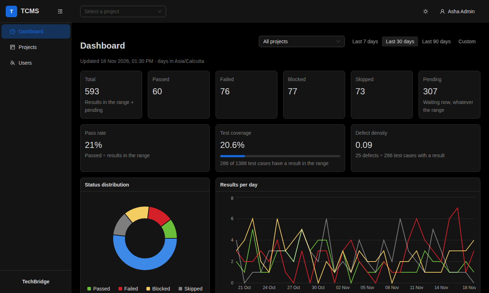

## PRD coverage

Where the assignment's frontend requirements live. Server-side rules (JWT, RBAC middleware, Redis, rate
limiting, validation, Swagger, schema) are in the tcms-api repository.

| PRD requirement | Where |
| --- | --- |
| Login, JWT, protected routes | `features/auth`: `AuthProvider`, `ProtectedRoute`. The JWT stays in an httpOnly cookie that scripts can't read; the session is restored with `GET /auth/me` on load, and any `401` signs out with a return link |
| RBAC: conditional rendering | `can(resource, permission)` from the auth context reads the API's permission map (no role-name checks). `RequirePermission` shows a 403 page. Execution buttons stay visible but disabled for read-only users |
| Projects, team members | `features/project` (admin and test lead create/edit; team picker searches the server) |
| Test cases: CRUD, steps, tags, suites, search and filters, bulk | `features/test-case`. Filters, sort and page live in the URL; search is debounced; bulk delete, priority, add to suite and assign to tester each send one request |
| Test execution: results, comments, attachments, defects, history, audit, assignment, progress | `features/test-execution`, `defect`, `attachment` |
| Test suites: add/remove/reorder, run a whole suite, suite report | `features/test-suite`, `suite-run` |
| Dashboard for every role | `features/analytics`: summary, pass rate, coverage, defect density, trend, by priority/type, by tester |
| `useContext`: auth, theme, current project, permissions | `features/auth/auth.context.ts`, `shared/theme/theme.context.ts`, `features/project/current-project.context.ts` |
| `useCallback`: test case form, execution components | `TestCaseForm`, `TestCaseStepsField`, `ExecutionResultForm` (with `React.memo` on `ExecutionStepRow`), `TestSuiteForm` |
| `useMemo`: statistics, pass rates, coverage, test case list | `DashboardPage`, the analytics charts, `ExecutionProgressSummary`, `ExecutionStatusPie`, `TestCasePaginationPage` |
| `React.lazy` + `Suspense` per route | every `features/*/*.routes.tsx`; the `Suspense` boundary is in `AppLayout` |
| Virtual scrolling | the test case list at page sizes of 50 and 100 (antd `Table` `virtual`) |
| Lazy-loaded execution history | `TestCaseViewPage` loads `TestCaseExecutionHistory` with `React.lazy` when its section is opened |
| Charts (Recharts): pie, line, bar | status pie (dashboard, suite report), daily trend line, bars by priority/type and by tester |
| Pagination | server-side on every list (20 / 50 / 100) |
| Caching effectiveness (Live Demo) | **Cache metrics** page (admin) |
| Bonus: dark mode | `shared/theme` (light by default, choice remembered per browser) |

Decisions that differ from the assignment's wording:

- **No self-registration.** Users don't sign themselves up, because a sign-up form would let anyone grant
  themselves a role. Instead an admin invites them, and each user sets their own password from an emailed,
  single-use link.
- **Rate limiting is enforced by the API only.** When a limit is hit, the UI shows its generic error.
- **Data is cached on the server, not in the browser.** Redis caches reads and clears them on writes, so the UI
  always asks for fresh data (TanStack Query with `staleTime` 0).

## Environment

| Variable | Purpose | Default (`.env.development`) |
| --- | --- | --- |
| `VITE_TCMS_API_URL` | API root the axios client calls | `/api` |
| `VITE_TCMS_API_MOCKING` | `true` serves API calls from MSW mocks (dev only) | `true` |

To use a locally running backend (tcms-api on port 3000), create `.env.development.local` (git-ignored):

```bash
VITE_TCMS_API_MOCKING=false
```

The Vite dev server proxies `/api` to `http://localhost:3000`, so `VITE_TCMS_API_URL` stays `/api` and
the browser sees one origin (no CORS). `.env.production` holds the production build's settings; MSW is never
part of the production bundle.

## Scripts

| Command | Description |
| --- | --- |
| `npm run dev` | Start the dev server |
| `npm run build` | Type-check and build for production |
| `npm run lint` | Lint with type-aware ESLint rules |
| `npm test` | Run the unit tests (Vitest) |
| `npm run preview` | Serve the production build locally |

## Project structure

```text
src/
├── app/            # bootstrap: providers, router, navigation, i18n, axios client, MSW setup
├── features/       # one folder per domain (auth, user, project, test-case, test-suite, test-execution,
│                   #   suite-run, defect, attachment, analytics): pages, components, API, DTOs, mocks
├── shared/         # cross-feature pieces: layout, form controls, charts' legend, theme, formatters
└── styles/         # global SCSS partials
document/screenshots/  # user-guide screenshots
```
